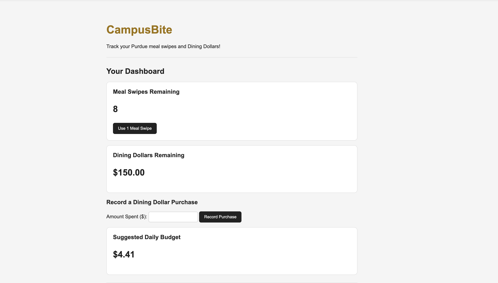
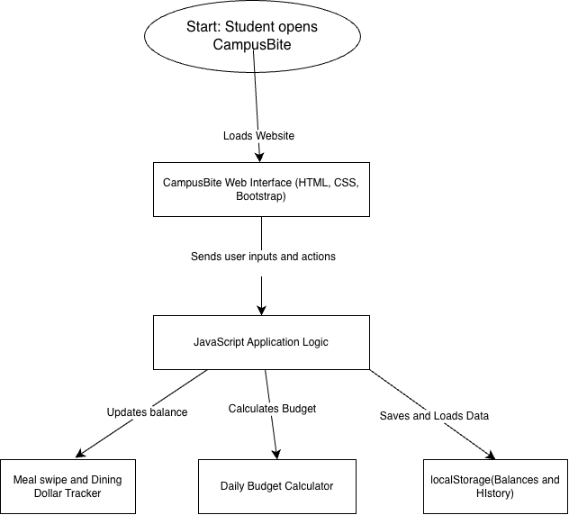

# CampusBite-193

CampusBite is a simple web application that helps Purdue students track their meal swipes and Dining Dollars.

## The Problem

Students can check their remaining meal plan balances, but it can be difficult to know if they are spending too quickly. CampusBite makes it easier to track meal plan usage and plan a daily budget.

## Features

- Enter starting meal swipes and Dining Dollars.
- Record meal swipe usage.
- Record Dining Dollar purchases.
- Automatically update remaining balances.
- Calculate a suggested daily Dining Dollar budget.
- View transaction history.
- Save information between browser sessions.
- View a graph of Dining Dollar spending over the last seven days.

## Screenshot

## Technologies Used

- HTML for webpage structure
- CSS for styling
- JavaScript for application functionality
- localStorage for saving data
- Git and GitHub for version control

No backend, database, or external API is required.

## How to Run

1. Open a terminal.
2. Clone the repository:

   git clone https://github.com/CricketGOAT22/CampusBite-193.git

3. Enter the project folder:

   cd CampusBite-193

4. On a Mac, run:

   open index.html

Alternatively, double-click index.html to open the application in a web browser.

No extra installations, database, or server are required.

## Example Input and Output

Example starting values:
- Meal Swipes: 10
- Dining Dollars: $100.00
- Days Remaining: 20

Initial dashboard:
- Meal Swipes Remaining: 10
- Dining Dollars Remaining: $100.00
- Suggested Daily Budget: $5.00

After using 1 meal swipe and spending $10:
- Meal Swipes Remaining: 9
- Dining Dollars Remaining: $90.00
- Suggested Daily Budget: $4.50

Both transactions appear in the transaction history.
The $10 purchase also appears in the weekly spending graph.

No installation or additional software is needed to run the application.

## System Diagram

The diagram below shows how the CampusBite website,
JavaScript logic, budget calculator, and localStorage
work together.

## How to Use

1. Enter your starting meal swipes, Dining Dollars, and semester end date.
2. Click "Save Meal Plan".
3. Click "Use 1 Meal Swipe" whenever you use a swipe.
4. Enter the amount spent and click "Record Purchase" after using Dining Dollars.
5. View your remaining balances, suggested daily budget, transaction history, and weekly spending graph.

## How the Budget Works

CampusBite divides the remaining Dining Dollar balance by the number of days left until the semester end date, including today.

For example, if a student has $100 remaining and 20 days left, the suggested daily budget is $5.

## Data Storage

CampusBite uses the browser's localStorage to save meal plan information and transactions.

Data is saved in the current browser and does not automatically sync between devices.

Starting a new meal plan resets the previous transaction history.

## Extra Feature

The weekly spending graph was developed on a separate Git branch and merged into main after testing.

It displays Dining Dollar purchases from the last seven days.

## Future Improvements

- Low-balance notifications
- Personalized spending recommendations
- Purdue dining menu integration

## Development Roadmap

- [x] Set up GitHub repository and project files
- [x] Create the dashboard and meal plan setup
- [x] Add meal swipe tracking
- [x] Add Dining Dollar purchase tracking
- [x] Add transaction history
- [x] Save data using localStorage
- [x] Add daily budget calculator
- [x] Test features and fix bugs
- [x] Improve website styling and mobile layout
- [x] Add weekly spending graph using a feature branch
- [x] Merge the completed graph into main
- [ ] Complete final testing and documentation
- [ ] Record and upload video walkthrough

## Project Status

The MVP and weekly spending graph are implemented. Final documentation, testing, and video preparation are in progress.

## Demo

A 3–4 minute video walkthrough will be added here
after the final recording is completed.

